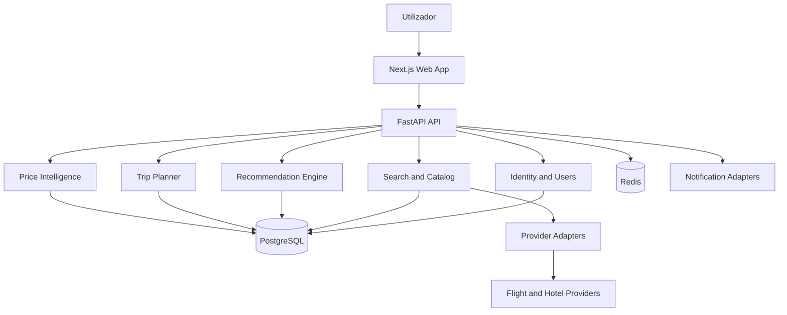

# Arquitetura do Sistema SKY

## 1. Objetivo

Definir uma arquitetura evolutiva para pesquisa, comparação e planeamento de viagens, preparada para suportar reservas, pagamentos e pós-venda numa fase posterior.

## 2. Estilo arquitetural

O ponto de partida é um **monólito modular**. A aplicação será implantada inicialmente como um backend principal, mas organizada por módulos de domínio, interfaces explícitas e dependências controladas.

Esta opção reduz a complexidade operacional inicial e permite separar serviços no futuro se existirem razões mensuráveis, como carga independente, requisitos de disponibilidade ou ciclos de desenvolvimento distintos.

## 3. Vista lógica

O diagrama representa a arquitetura pretendida, não serviços já implementados.

## 4. Aplicações e pacotes

- `apps/web`: aplicação web Next.js.
- `apps/api`: API FastAPI e módulos de domínio.
- `packages/design-tokens`: tokens partilhados de cor, espaçamento e tipografia.
- `packages/ui`: componentes visuais reutilizáveis.
- `packages/shared-types`: contratos partilhados quando aplicável.
- `infrastructure`: Docker, proxy e observabilidade.
- `docs`: arquitetura, API, dados, segurança e decisões.

## 5. Módulos de domínio

MVP:
- `auth` e `users`
- `search`
- `flights` e `hotels`
- `providers`
- `recommendations`
- `prices` e `alerts`
- `favorites`
- `trip_planner`
- `notifications`

Futuro:
- `booking`
- `payments`
- `reservation_management`
- `refunds`
- `customer_support`

## 6. Fluxo de pesquisa

1. A web app envia critérios de pesquisa validados.
2. A API verifica autorização, limites e parâmetros.
3. O módulo de pesquisa seleciona fornecedores compatíveis.
4. Adaptadores convertem respostas externas para o modelo canónico SKY.
5. Os resultados normalizados são filtrados e persistidos apenas quando necessário.
6. O Recommendation Engine calcula critérios e pontuação.
7. A API devolve resultados, explicação e informação de origem.

Os fornecedores podem ter cobertura, disponibilidade, moeda e condições diferentes. A interface deve apresentar essas limitações com clareza.

## 7. Integrações

Cada fornecedor terá um adaptador isolado. A lógica de domínio não deve depender dos formatos proprietários de um fornecedor. A seleção comercial e técnica de APIs de voos, hotéis, mapas, email e pagamentos permanece pendente de avaliação.

Não assumir que uma API permite reservas, alertas ou acesso comercial sem validar contrato, preços, cobertura geográfica e condições de utilização.

## 8. Dados e consistência

- PostgreSQL é a fonte de verdade para dados persistentes da plataforma.
- Redis é auxiliar: cache, throttling e coordenação de tarefas quando necessário.
- Valores monetários devem usar decimal e código ISO 4217.
- Datas e horas devem ser armazenadas em UTC e apresentadas no fuso do utilizador/destino.
- Respostas de fornecedores devem conservar referência, instante de recolha e validade quando aplicável.

## 9. Preparação para reservas

O domínio futuro de reservas deverá ter estados explícitos, idempotência, webhooks autenticados, trilho de auditoria e reconciliação com o fornecedor. A criação de uma reserva e a confirmação de pagamento não devem ser tratadas como uma única operação atómica distribuída.

## 10. Qualidade operacional

- Configuração por ambiente.
- Segredos fora do controlo de versões.
- Logs estruturados sem dados pessoais desnecessários.
- Métricas de latência, erros e disponibilidade dos fornecedores.
- Testes unitários, integração e ponta a ponta.
- CI com lint, type-check, testes e análise de dependências.

## 11. Decisões em aberto

- Fornecedor(es) de voos e hotéis.
- Estratégia de tarefas assíncronas e respetiva tecnologia.
- Política de retenção de pesquisas e preços.
- Provedor de identidade.
- Provedor de pagamentos para a fase futura.
- Estratégia de alojamento e observabilidade.

## 12. Estado

Documento de arquitetura proposto. Não representa uma implementação já operacional.
