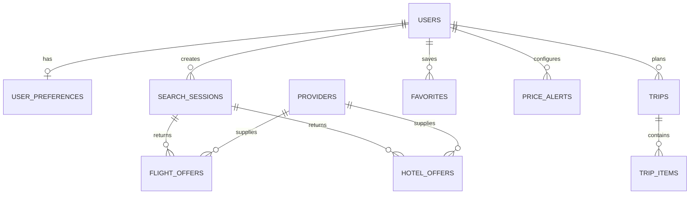

# Modelo de Dados SKY

## Princípios

- PostgreSQL como persistência principal.
- Identificadores internos estáveis, preferencialmente UUID.
- Timestamps em UTC.
- Valores monetários em tipo decimal, acompanhados de moeda ISO 4217.
- Integridade referencial e restrições na base de dados.
- Dados externos identificados pela origem e referência do fornecedor.
- Minimização e retenção limitada de dados pessoais.

## Entidades previstas para o MVP

| Entidade | Responsabilidade |
|---|---|
| users | Conta e identidade interna |
| user_preferences | Preferências de viagem e pesquisa |
| search_sessions | Pesquisas efetuadas |
| search_criteria | Critérios normalizados da pesquisa |
| providers | Catálogo de fornecedores |
| flight_offers | Ofertas de voo normalizadas |
| hotel_offers | Ofertas de alojamento normalizadas |
| price_observations | Observações de preço ao longo do tempo |
| favorites | Itens guardados pelo utilizador |
| price_alerts | Regras de alerta |
| trips | Viagens planeadas |
| trip_items | Elementos de um itinerário |

## Relações conceptuais

## Campos transversais recomendados

Quando aplicável:
- `id`: UUID.
- `created_at` e `updated_at`: timestamp UTC.
- `provider_id` e `provider_reference`: rastreabilidade de origem.
- `currency`: código ISO 4217.
- `observed_at` e `expires_at`: validade temporal da informação externa.

## Ofertas e preços

Uma oferta não deve ser tratada como preço garantido. O modelo deve conservar:
- Preço total conhecido e moeda.
- Componentes incluídos/excluídos, quando fornecidos.
- Condições de bagagem, cancelamento e alteração, quando disponíveis.
- Fornecedor e referência externa.
- Momento da recolha e validade/expiração.
- Estado de disponibilidade, se fornecido.

A interface deve distinguir preço observado, preço indicativo e preço confirmado pelo fornecedor.

## Reservas e pagamentos — fase futura

Entidades futuras possíveis:
- `bookings`
- `booking_items`
- `booking_status_events`
- `payment_attempts`
- `payment_webhook_events`
- `refunds`

Não armazenar números completos de cartões nem códigos de segurança. Guardar apenas referências/tokens do prestador e metadados estritamente necessários.

## Migrações e integridade

As alterações ao esquema devem ser versionadas por migrações. Evitar alterações manuais não reproduzíveis em ambientes partilhados. Definir índices com base em consultas reais e medir antes de otimizar.

## Estado

Modelo conceptual inicial. Não existe ainda esquema SQL ou migrações implementadas.
